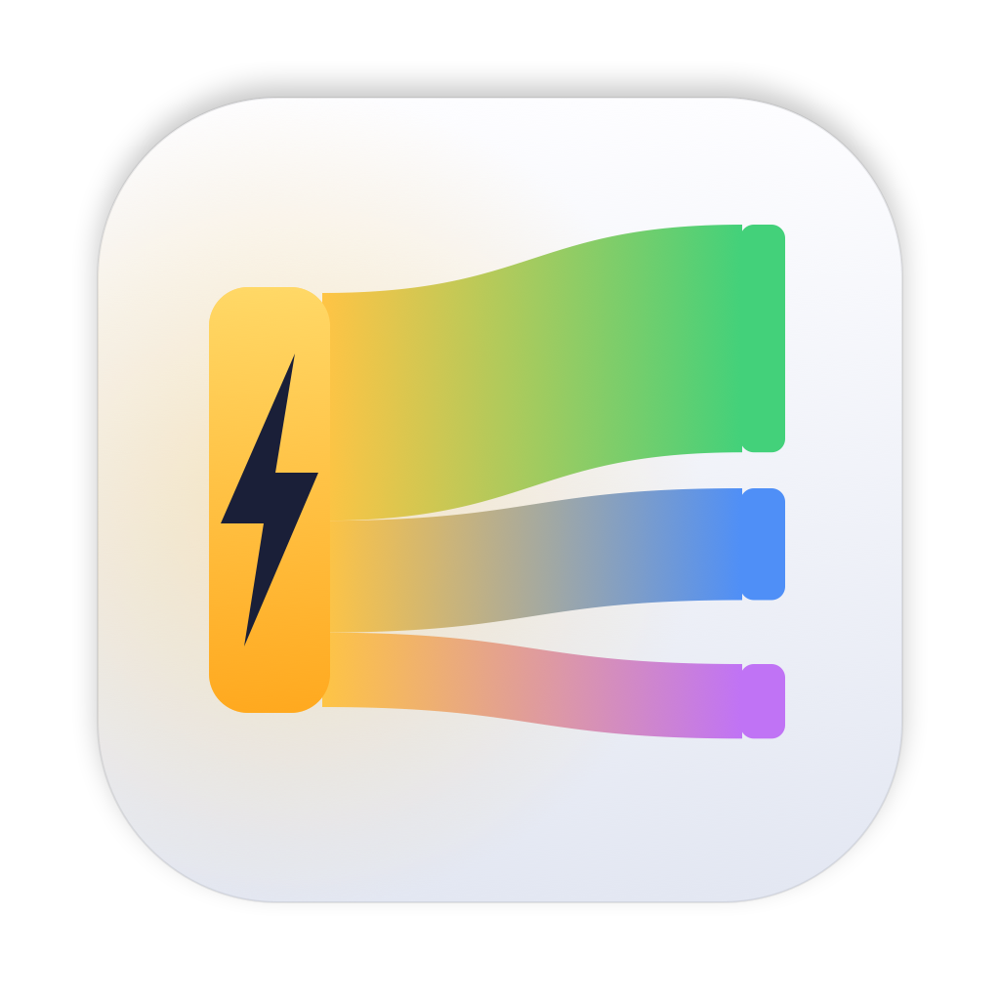
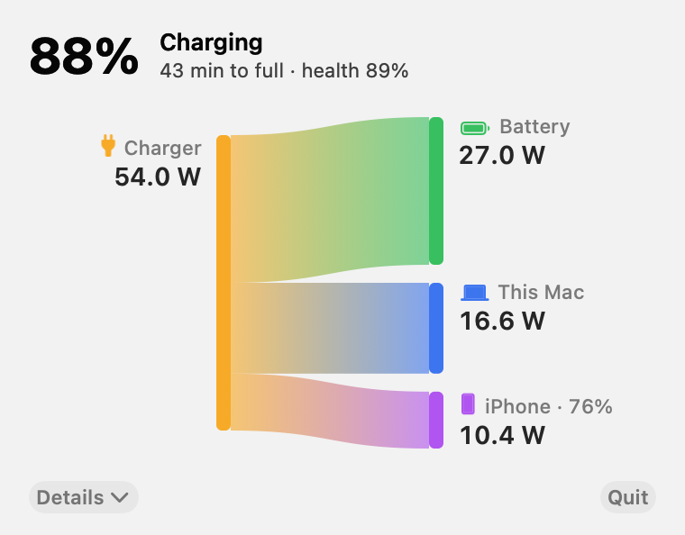

<p align="center">
  <picture>
    <source media="(prefers-color-scheme: dark)" srcset="icon/icon_1024.png">
    
  </picture>
</p>

<h1 align="center">PowerFlow</h1>

A tiny macOS menu bar app that shows, live, where your MacBook's charging power goes:
**how much goes into the battery, how much the Mac itself uses, and how much goes out to
devices charging from its USB-C ports** (e.g. an iPhone).

一个小巧的 macOS 菜单栏工具，实时显示 MacBook 的充电功率去向：多少进了电池、多少被 Mac 自己用掉、
多少通过 USB-C 输出给了外接设备（比如 iPhone）。

<p align="center">
  <picture>
    <source media="(prefers-color-scheme: dark)" srcset="docs/panel-dark.png">
    
  </picture>
</p>

## Features

- Lives in the menu bar (no Dock icon). Minimal SF Symbols readout: bolt `54W` · battery `+27` · device `10`
- Click it for a drop-down panel with a branching flow diagram: charger (and battery, when it has
  to help) → battery / this Mac / each USB-C device. **Details** expands a 10-minute history and
  charger, cable and battery stats in the same panel
- Recognizes what's plugged in — iPhone, iPad, Apple Watch, AirPods, etc. — with its icon, name
  and its own battery %
- Battery health (current vs. design capacity) and cycle count
- Light and dark app icon that follows the system appearance (macOS 26+)
- One-click updates: when a new release is out, an **Update** button appears in the panel (and a
  dot in the menu bar). It downloads the release, checks its SHA-256 and code signature, swaps
  the app in place and relaunches
- Tiny footprint: under 0.1% CPU and about 16 MB of memory; nothing is drawn while the panel is
  closed, and the menu bar only redraws when its numbers change
- No root, no kernel extensions. Network use is limited to one small request to GitHub on launch
  and once a day to check for updates — turn it off with
  `defaults write io.github.powerflow autoCheck -bool false`

## Install

1. Download `PowerFlow.zip` from the [latest release](../../releases/latest) and unzip it.
2. Move `PowerFlow.app` to `/Applications`.
3. The app is not notarized by Apple, so the first launch is blocked. Either:
   - Right-click the app → **Open** → **Open**, or on newer macOS go to
     **System Settings → Privacy & Security** and click **Open Anyway**; or
   - run `xattr -dr com.apple.quarantine /Applications/PowerFlow.app`

## Build from source

Requires Xcode command line tools (Swift 5.9+), macOS 14+. Full Xcode 26 adds the light/dark icon.

```bash
git clone https://github.com/lvcidnu11/PowerFlow.git
cd PowerFlow
./build.sh
open PowerFlow.app
```

## How it works / caveats

Values come from the undocumented `PowerTelemetryData`, `PowerOutDetails` and `FedDetails`
keys of `AppleSmartBattery`. They're what Apple's own firmware reports, but they aren't a
public API and may change between macOS versions.

- **Mac** is computed as `SystemLoad − USB-C output`.
- Best supported on Apple Silicon MacBooks. Intel Macs expose fewer keys; the app falls back
  to battery voltage × current, and per-port output may be missing.
- Independently sampled values don't always add up exactly; any gap is shown as
  "Conversion / other".

**How devices are identified.** Two sources are combined per USB-C port:

| Source | Gives | Needs |
|---|---|---|
| USB-C Power Delivery (`FedDetails`) | vendor (e.g. Apple), the device's battery % | any USB-C cable |
| USB enumeration (`IOUSBHostDevice`) | product name: "iPhone", "iPad", … | a data cable |

The product name picks the icon (iPhone → `iphone`, iPad → `ipad`, …). With a charge-only
cable the device shows as "Apple device" / "USB-C device" with a generic connector icon.
Ports are matched by USB controller (one per USB-C port on Apple Silicon).

**Debugging.** `PowerFlow.app/Contents/MacOS/PowerFlow --dump` prints one reading and exits —
please include its output in bug reports. `--update` checks for and installs an update from the
terminal; `--snapshot <dir>` renders the panel to PNGs.

**Does charging a phone from the Mac wear the Mac's battery?** While the Mac is plugged in,
USB-C devices are fed from the system power rail, which the adapter supplies — the battery is
not discharged to charge them unless total demand exceeds what the adapter can deliver. When
that happens, PowerFlow shows the battery as a second source.

## License

MIT
